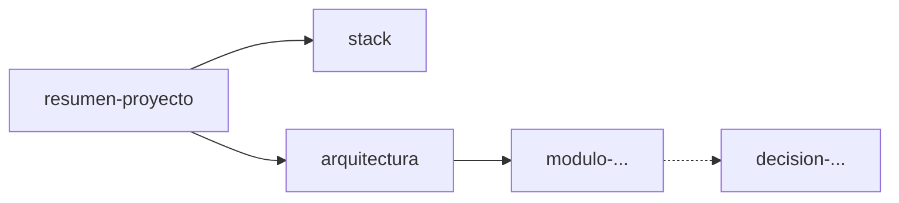

# Documentación de <nombre-del-proyecto>

Punto de entrada del grafo de conocimiento. Empieza por [[resumen-proyecto]].

## Nodos

| Nodo | Tipo | Qué contiene | Relacionado |
|---|---|---|---|
| [[resumen-proyecto]] | resumen | Propósito y partes más importantes | [[stack]], [[arquitectura]] |
| [[stack]] | stack | Tecnologías, versiones, build/run | [[arquitectura]] |
| [[arquitectura]] | arquitectura | Componentes y flujo de datos | modulos |
| [[modulo-<nombre>]] | modulo | <una línea> | <nodos> |
| [[decision-YYYYMMDD-<slug>]] | decision | <una línea> | <nodos> |
| [[runbook-<slug>]] | runbook | <una línea> | <nodos> |

## Grafo

<!-- Flechas sólidas: "se apoya en / contiene". Punteadas: "motivado por / ver también". -->

## Pendientes

Nodos referenciados con un wiki-link que aún no existen:

- (ninguno)
